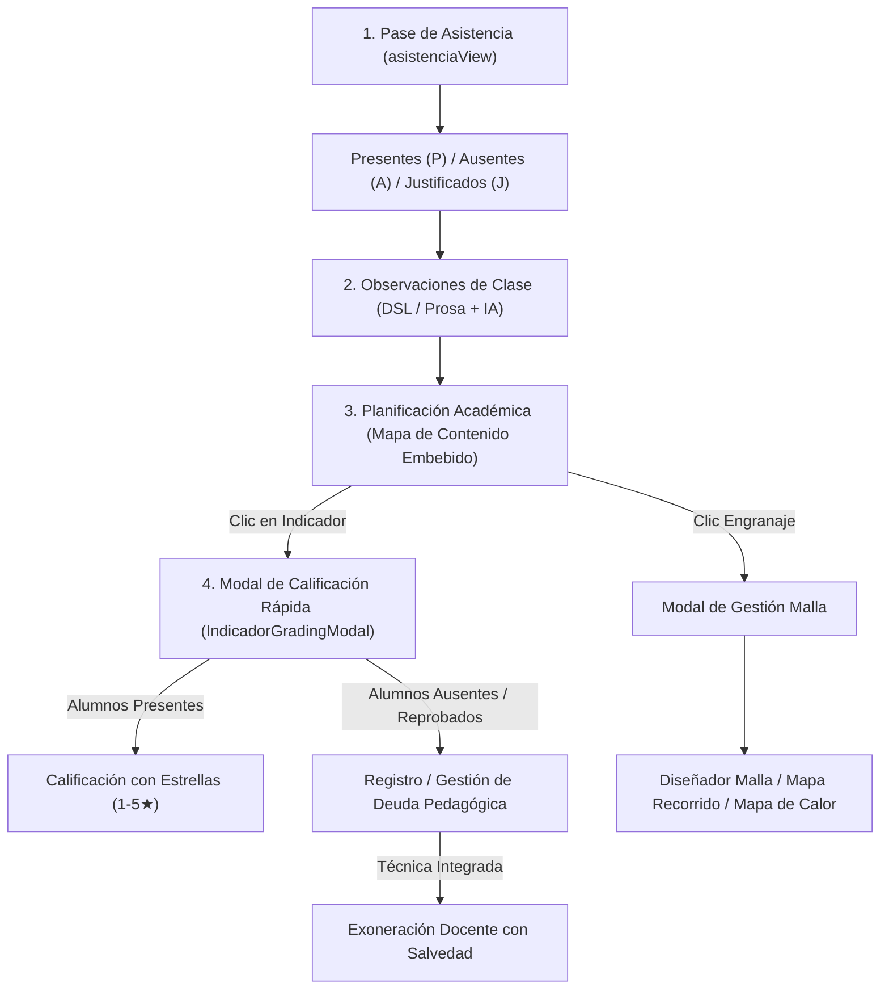
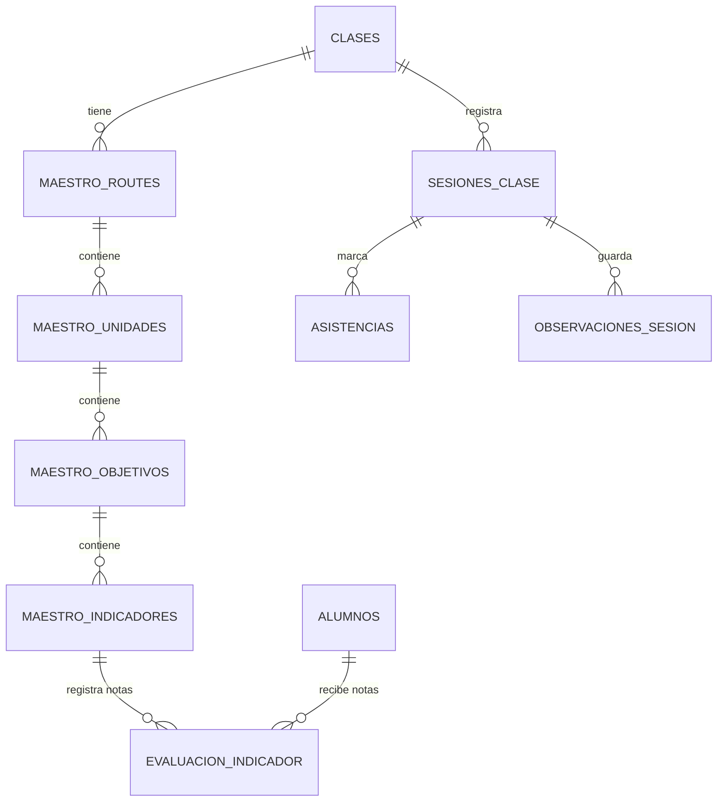

# Especificación Integral: Malla Curricular, Evaluación Continua y Deudas Pedagógicas
**Módulo:** Portal de Maestros — Sistema de Orquestas e Instituciones Musicales (SOI)  
**Fecha:** Octubre 2026  
**Documento para:** Revisión de Arquitectura, UX y Co-Diseño (Claude / Equipo de Ingeniería)

---

## 1. Visión General y Contexto Pedagógico

En la enseñanza orquestal y de conservatorio (modelo El Sistema), el progreso de un estudiante en una cátedra de instrumento o práctica colectiva no es lineal ni homogéneo. Un docente trabaja semanalmente con ensambles y clases grupales donde:
1. **Cada clase tiene un objetivo pedagógico:** Se abordan indicadores de técnica instrumental (ej. golpe de arco *martellato*, postura de mano izquierda, afinación en cambios de posición, lectura rítmica).
2. **La asistencia y el desempeño van de la mano:** Si un estudiante falta o se ausenta justificadamente, no recibe la instrucción del indicador de ese día, generándose una **laguna técnica** o **Deuda Pedagógica**.
3. **El bloqueo de contenido es blando (Soft Prerequisite):** En música no se puede paralizar a un estudiante indefinidamente si no domina un micro-indicador puntual; el grupo avanza. Sin embargo, antes de culminar un período lectivo o pasar de unidad, las deudas pedagógicas deben saldarse para evitar vicios técnicos.
4. **Exoneración por Competencias Integradas:** Si un estudiante faltó a la clase de "uso del segundo dedo de la mano izquierda", pero meses después ejecuta correctamente "escalas mayores a dos octavas", la habilidad previa ha quedado tácitamente asimilada y superada. El sistema debe permitir al docente **exonerar la deuda con evidencia pedagógica**, sin forzarlo a repetir un ejercicio básico ya superado.

---

## 2. Mapa de Situaciones y Experiencia de Usuario (User Journey)

El flujo diario del maestro se organiza en cinco momentos interconectados:

### Situación 1: Pase de Asistencia Limpio
- El maestro ingresa a la sesión de la clase.
- **Sin elementos distractores:** La lista de alumnos (`#pm-alumnos-list`) se ubica directamente en la parte superior.
- Cada alumno cuenta con selector táctil de estado: **P** (Presente), **J** (Justificado), **A** (Ausente).
- Al pie de la pantalla, un **botón flotante (FAB)** abajo a la derecha permite guardar la sesión en cualquier momento sin bloquear los botones de asistencia del fondo (`pointer-events: none` en contenedor, `pointer-events: auto` en el botón).

### Situación 2: Observación de Clase contextualizada
- Sección de texto enriquecido o DSL (`[martellato] Alumno1=5 Alumno2=3`).
- Al seleccionar o evaluar un indicador de la malla, el nombre del indicador se inyecta automáticamente en el editor (`[Indicador de Hoy] `), unificando el diario de clase con el currículo.

### Situación 3: Visualización del Mapa de Contenido de la Malla
- La tarjeta **Planificación Académica** se encuentra expandida por defecto.
- Muestra el árbol jerárquico completo (**Unidades → Objetivos → Indicadores**) desplegado en toda su altura (`max-height: none`), sin barras de desplazamiento internas que recorten la vista.
- Cada nodo indicador cuenta con semáforo y estado visual:
  - ⚪ **Pendiente:** Ningún alumno ha sido calificado.
  - ⭐ **En proceso:** Al menos un alumno ha sido calificado.
  - 👑 **Dominado:** El 100% de los alumnos de la clase han aprobado el indicador (≥3★ o recuperado).
  - 🎯 **Indicador Actual:** Resaltado con borde activo y badge "ACTUAL".
- **Botón de Engranaje (<i class="bi bi-gear-fill"></i>):** Abre el modal de **Gestión Curricular** que centraliza:
  1. Estado del Indicador de Hoy con botón de evaluación en 1-tap.
  2. Cambio rápido de tema de hoy mediante selector en cascada (Unidad → Objetivo).
  3. Acceso a Diseñar/Editar Malla Curricular (`TeacherRouteBuilder`).
  4. Acceso al Mapa de Recorrido Pedagógico (`teacherRouteMapPanel`).
  5. Acceso al Mapa de Calor de Evaluaciones (`abrirModalMapaDeCalor`).

### Situación 4: Calificación Rápida por Estrellas (`IndicadorGradingModal`)
- Al tocar cualquier indicador en el mapa o pulsar "Evaluar alumnos (1 tap)":
- Se despliega un modal comprimido y denso:
  - **Presentes:** Lista de alumnos presentes ese día con selector de 1 a 5 estrellas (⭐):
    - **1 a 2 estrellas:** Desempeño insuficiente → se marca como deuda para refuerzo.
    - **3 a 4 estrellas:** Aprobado satisfactoriamente.
    - **5 estrellas:** Dominio excelente de la técnica.
  - **Ausentes o Justificados:** Marcados automáticamente con alerta de **Deuda Pedagógica**.
  - **Resolución de Deuda:** El maestro puede resolver deudas desde el mismo modal:
    - *Recuperado en clase:* El alumno practicó y superó el ejercicio en clase.
    - *Exonerado:* El alumno aprendió una técnica superior que ya integra la pendiente.
    - *No recuperable / Justificado:* Cierre administrativo de la deuda.

### Situación 5: Vista Panorámica y Mapa de Calor (`planificacionView`)
- Matriz bidimensional Alumnos × Indicadores.
- Permite al director de cátedra y al maestro ver de un vistazo qué alumnos van al día y quiénes arrastran lagunas antes de avanzar a la siguiente unidad formativa.

---

## 3. Modelo de Datos y Esquema de Base de Datos

### Tablas Principales

1. **`maestro_routes`**:
   - `id` (UUID, PK)
   - `clase_id` (UUID, FK a `clases`)
   - `maestro_id` (UUID, FK a `maestros`)
   - `nombre` (TEXT)
   - `created_at`, `updated_at`

2. **`maestro_unidades`**:
   - `id` (UUID, PK)
   - `route_id` (UUID, FK a `maestro_routes`)
   - `orden` (INTEGER)
   - `nombre` (TEXT)
   - `descripcion` (TEXT)

3. **`maestro_objetivos`**:
   - `id` (UUID, PK)
   - `unidad_id` (UUID, FK a `maestro_unidades`)
   - `orden` (INTEGER)
   - `nombre` (TEXT)
   - `descripcion` (TEXT)

4. **`maestro_indicadores`**:
   - `id` (UUID, PK)
   - `objetivo_id` (UUID, FK a `maestro_objetivos`)
   - `orden` (INTEGER)
   - `nombre` (TEXT)
   - `criterios_json` (JSONB) — rúbrica o criterios de evaluación

5. **`evaluacion_indicador`**:
   - `id` (UUID, PK)
   - `clase_id` (UUID, FK a `clases`)
   - `alumno_id` (UUID, FK a `alumnos`)
   - `maestro_indicador_id` (UUID, FK a `maestro_indicadores`)
   - `nota` (NUMERIC 1-5)
   - `recovery_status` (TEXT: `'recuperado'`, `'exonerado'`, `'no_recuperable'`, NULL)
   - `recovery_notes` (TEXT) — justificación pedagógica
   - `evaluado_por` (UUID, FK a `maestros`)
   - `created_at`, `updated_at`

6. **`observaciones_sesion`**:
   - `id` (UUID, PK)
   - `sesion_id` (UUID, FK a `sesiones_clase`)
   - `maestro_id` (UUID, FK a `maestros`)
   - `contenido_raw` (TEXT) — texto original o DSL
   - `contenido_parsed` (JSONB) — evaluaciones cuantificadas
   - `contenido_ia_dsl` (TEXT, opcional)
   - `es_borrador` (BOOLEAN)

---

## 4. Fórmulas de Cálculo y Lógica de Negocio

### 1. Estado de Aprobación Individual
Para un alumno $A$ en el indicador $I$:
$$\text{Aprobado}(A, I) = (\text{nota} \ge 3) \lor (\text{recovery\_status} \in \{\text{'recuperado'}, \text{'passed'}\}) \lor (\text{recovery\_status} = \text{'exonerado'})$$

### 2. Estado del Nodo Indicador para la Clase
Para una clase con $N$ estudiantes matriculados:
- **Dominado (👑):** $\sum_{A} \mathbb{I}(\text{Aprobado}(A, I)) \ge N \quad (N > 0)$
- **En Proceso (⭐):** $\text{Total Evaluados}(I) > 0 \land \sum_{A} \mathbb{I}(\text{Aprobado}(A, I)) < N$
- **Pendiente (⚪):** $\text{Total Evaluados}(I) = 0$

### 3. Cálculo de Promedio por Objetivo y Unidad
Para un objetivo o unidad con $k$ indicadores evaluados:
$$\bar{X}_{\text{alumno}} = \frac{\sum_{i=1}^{k} \text{nota}_i}{k}$$
*Nota:* Las evaluaciones exoneradas o recuperadas computan como nota base aprobatoria ($\ge 3$) según la salvedad registrada.

### 4. Deuda Pedagógica Activa
Se considera que un estudiante tiene una deuda activa si:
$$\text{Deuda}(A, I) = (\text{asistencia} \in \{\text{'A'}, \text{'J'}\}) \lor (\text{evaluado} \land \text{nota} \le 2 \land \text{recovery\_status} \text{ es NULL})$$

---

## 5. Mapeo de Archivos y Componentes Clave

| Componente | Archivo | Responsabilidad Principal |
|---|---|---|
| **Asistencia Principal** | `src/portal-maestros/views/asistenciaView.js` | Lista de alumnos limpia, FAB flotante de guardado, inyección de indicador activo, modal de gestión de malla (`#btn-manage-planning`). |
| **Tarjeta Planificación** | `src/portal-maestros/components/attendance/PlanificationCard.js` | Renderizado del árbol de unidades y objetivos con mapa de indicadores clicables, estado actual y sin límites de scroll. |
| **Modal Calificación** | `src/portal-maestros/components/IndicadorGradingModal.js` | Modal denso y compacto para calificar presentes con estrellas (1-5★) y resolver deudas pedagógicas (recuperar/exonerar). |
| **Mapa de Calor** | `src/portal-maestros/views/planificacionView.js` | Matriz bidimensional alumnos × indicadores, visualización de promedios y deudas acumuladas. |
| **Constructor de Malla** | `src/portal-maestros/components/TeacherRouteBuilder.js` | Interfaz CRUD para estructurar unidades, objetivos e indicadores de la cátedra. |
| **Rutas Verticales** | `src/portal-maestros/components/teacherRouteMapPanel.js` | Visualización en formato de recorrido continuo con progresión de hitos y prelaciones. |
| **Servicio de Guardado** | `src/portal-maestros/services/autoDraftService.js` | Persistencia resiliente con tolerancia a esquemas en evolución y cola IndexedDB offline. |

---

## 6. Oportunidades de Mejora y Preguntas Abiertas para Claude

A continuación se plantean los puntos clave de diseño donde se solicita análisis y propuestas de mejora:

### A. Rendimiento en Clases Numerosas (Orquestas / Coros con 40+ alumnos)
- *Desafío:* La matriz del mapa de calor y el modal de calificación cargan todos los alumnos a la vez.
- *Pregunta para Claude:* ¿Cuál es el patrón recomendado para mantener la fluidez táctil en dispositivos móviles de gama baja sin sacrificar la visión simultánea de las estrellas?

### B. Ciclo de Vida y Notificaciones de Deudas Pedagógicas
- *Desafío:* El maestro puede no recordar qué alumnos arrastran deudas de unidades anteriores al planificar la clase de hoy.
- *Pregunta para Claude:* ¿Cómo estructurar un "resumen de alertas pedagógicas" o badge inteligente en el encabezado de asistencia que avise sutilmente: *"3 alumnos presentes tienen deuda en el prerrequisito del tema de hoy"*?

### C. Auditoría y Trazabilidad de Exoneraciones (Política R6 del Proyecto)
- *Regla R6:* *"La persona decide; el sistema recomienda. Toda recomendación lleva evidencia, qué acción y quién decide."*
- *Pregunta para Claude:* ¿Cómo diseñar el ledger o historial de auditoría cuando un docente exonera una deuda por competencia integrada (ej. registrar: `indicador_origen`, `indicador_evidencia`, `maestro_id`, `justificacion`)?

### D. Modo Offline Extendido
- *Desafío:* Muchos salones de ensayo no cuentan con buena señal WiFi/móvil durante las 2 o 3 horas de ensayo.
- *Pregunta para Claude:* ¿Cómo optimizar la cola de sincronización para que las calificaciones por estrellas y las asistencias se guarden localmente y se sincronicen en segundo plano sin colisiones de versiones?
